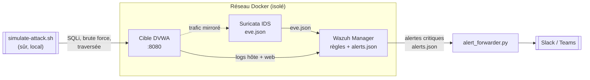

# SOC Detection Lab 🛰️

> Un **lab blue-team autonome basé sur Docker** : Wazuh (SIEM/HIDS) + Suricata
> (IDS réseau) + une cible volontairement vulnérable, livré avec du **contenu de
> détection personnalisé**, des **playbooks de réponse à incident alignés NIST**
> et un **forwarder d'alertes testé**. On le démarre, on l'attaque sans risque,
> et on voit les détections se déclencher de bout en bout.

🇬🇧 **English version → [README.md](README.md)**


---

## Pourquoi ce projet

N'importe qui sait installer un SIEM. Ce qu'un employeur (ou une équipe sécurité
d'ONG) veut vraiment voir, c'est si vous savez **écrire des détections, mener une
investigation et répondre**. Ce lab en est la preuve : détection-as-code
portable, vraies règles de corrélation, et runbooks directement utilisables —
le tout reproductible avec un seul `docker compose up`.

## Contenu

| Couche | Techno | Points clés |
|--------|--------|-------------|
| **SIEM / HIDS** | Wazuh 4.9 | Règles de corrélation (`config/wazuh/local_rules.xml`) : escalade brute-force SSH, règle de *compromission après brute-force*, exécution `curl\|sh`, SQLi web |
| **IDS réseau** | Suricata 7.0 | Règles locales (`config/suricata/custom.rules`) : scan de ports, brute-force SSH, SQLi, traversée de répertoire, téléchargements suspects |
| **Détection-as-code** | Sigma | Règles portables dans `detections/sigma/` + validateur exécuté en CI |
| **Automatisation** | Python (stdlib) | `tools/alert_forwarder.py` envoie les alertes critiques vers Slack/Teams — **16 tests, 0 dépendance** |
| **Réponse** | Markdown | Playbooks NIST SP 800-61 dans `playbooks/` |
| **Simulation** | Bash | `scripts/simulate-attack.sh` génère une télémétrie sûre, en local uniquement |

## Architecture



## Démarrage rapide

**Prérequis :** Docker + Docker Compose, ~4 Go de RAM.

```bash
cp .env.example .env
docker compose up -d
./scripts/healthcheck.sh
./scripts/simulate-attack.sh
docker compose exec wazuh.manager cat /var/ossec/logs/alerts/alerts.json > alerts.json
python tools/alert_forwarder.py --alerts alerts.json --min-level 8 --dry-run
```

> DVWA : <http://localhost:8080> (`admin` / `password`). API Wazuh sur `55000`.

## Couverture de détection (MITRE ATT&CK)

| Technique | ID | Détection |
|-----------|----|-----------|
| Brute Force : Password Guessing | T1110.001 | Wazuh 100100 / Suricata 1000002 / Sigma |
| Comptes valides (après brute-force) | T1078 | Wazuh 100101 (corrélation) |
| Shell Unix | T1059.004 | Wazuh 100110 / Sigma |
| Transfert d'outil (download) | T1105 | Sigma + Suricata 1000005 |
| Exploitation d'appli publique (SQLi) | T1190 | Wazuh 100120 / Suricata 1000003 / Sigma |

## Tests & qualité

```bash
pip install -r requirements-dev.txt
ruff check tools tests scripts
pytest                              # 16 tests
python scripts/validate_sigma.py
```

## ⚠️ Sécurité

Ce lab exécute **volontairement** des logiciels vulnérables avec des identifiants
faibles. Gardez-le sur un hôte/réseau isolé, ne l'exposez jamais à Internet, et
n'utilisez `simulate-attack.sh` que contre la cible fournie.

## Licence

MIT © 2026 Cedric Severin DJIGUIMDE — voir [LICENSE](LICENSE).
