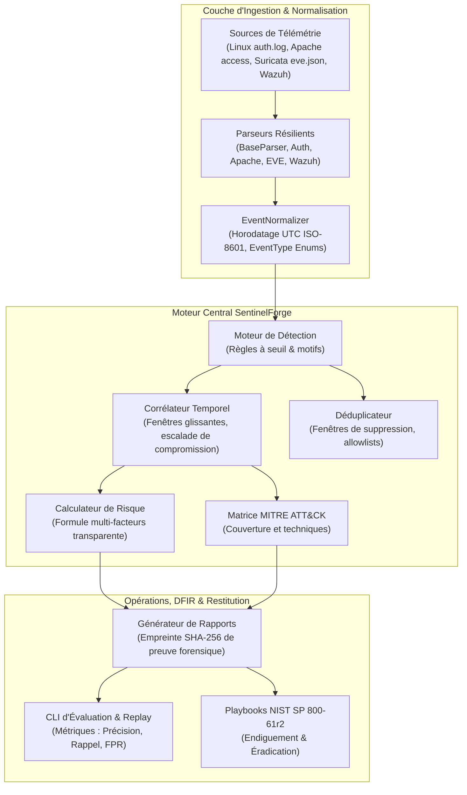

# SentinelForge — Plateforme de Détection de Sécurité & Réponse à Incident 🛡️

> **Une plateforme modulaire de cybersécurité défensive intégrant l'ingestion de télémétrie multi-sources, la corrélation d'événements à fenêtre glissante, un scoring de risque transparent et la génération automatisée de rapports d'incident conformes au NIST.**

🇬🇧 **Documentation anglaise principale → [README.md](README.md)** | **Détails de provenance & attribution → [CREDITS.md](CREDITS.md)**

[](tests)
[](https://www.python.org/)
[](LICENSE)
[](docs/DETECTION_ENGINE.md)

---

## 1. Présentation du Projet

**SentinelForge** est une plateforme défensive d'ingénierie de détection et de réponse à incident pour Security Operations Center (SOC), conçue et développée par **Evilyn** (étudiante en dernière année d'ingénierie cybersécurité à l'ENSI Tanger).

Dans les centres opérationnels de sécurité modernes, l'accumulation d'alertes isolées provenant de SIEMs ou d'IDS réseau engendre une fatigue informationnelle (*alert fatigue*) et masque la progression chronologique des cyberattaques. SentinelForge résout cette problématique en fournissant :

1. **Ingestion & Normalisation Découplée :** Conversion des journaux d'authentification Linux, des logs d'accès Apache, des événements réseau Suricata EVE et des alertes Wazuh en événements typés et horodatés en UTC strict (ISO-8601).
2. **Moteur de Détection Déterministe :** Exécution de règles basées sur des motifs syntaxiques et des seuils statistiques alignées sur le framework MITRE ATT&CK.
3. **Corrélation d'Événements à Fenêtre Glissante :** Détection de séquences d'attaque multi-étapes (ex. tentative répétée de brute-force SSH suivie immédiatement d'une authentification réussie avec compte valide).
4. **Scoring de Risque Multi-Facteurs Transparent :** Calcul mathématique explicable combinant sévérité de base, confiance de la règle, fréquence logarithmique et escalade de compromission.
5. **Gestion des Faux Positifs & Déduplication :** Suppression des tempêtes d'alertes identiques et gestion d'allowlists contextuelles (ex. vérifications de supervision locale).
6. **Replay & Benchmark Hors-Ligne Autonome :** Un exécuteur CLI (`sentinelforge`) permettant d'évaluer la précision, le rappel et le taux de faux positifs sur des jeux de données étiquetés, sans nécessiter Docker.

---

## 2. Architecture Globale du Système



---

## 3. Démarrage Rapide

### Prérequis
- Python 3.9+ (testé sous Python 3.12 et 3.14)
- Docker & Docker Compose (optionnel, requis uniquement pour le lab conteneurisé)

### Exécution Hors-Ligne (Replay de Télémétrie)
```bash
# Replay d'événements d'authentification SSH
python3 tools/sentinelforge_cli.py replay --file tests/fixtures/ssh_auth.log --format linux_auth

# Replay de logs d'accès web Apache
python3 tools/sentinelforge_cli.py replay --file tests/fixtures/apache_access.log --format apache_combined
```

### Évaluation des Métriques de Détection (Benchmark)
```bash
python3 tools/sentinelforge_cli.py benchmark --scenarios tests/fixtures/synthetic_events.json
```

### Exécution de la Suite de Tests
```bash
python3 -m pytest -v          # 85 tests validés
python3 scripts/validate_sigma.py
```

---

## 4. Documentation Technique

- [Architecture Système & Flux de Données](docs/architecture.md)
- [Guide d'Ingénierie de Détection & Spécification des Règles](docs/DETECTION_ENGINE.md)
- [Modèle de Menaces & Posture de Sécurité](docs/THREAT_MODEL.md)
- [Feuille de Route Technique](docs/ROADMAP.md)
- [Provenance & Crédits des Composants](CREDITS.md)
- [Playbook Réponse Incident : Brute-Force SSH](playbooks/ir-ssh-bruteforce.md)
- [Playbook Réponse Incident : Attaque Web](playbooks/ir-web-attack.md)

---

## 5. Attribution & Provenance

- **Moteur & Architecture SentinelForge :** © 2026 Evilyn (the-evilyn). Projet développé de manière indépendante (modèles de données, moteur d'ingestion/normalisation/détection/corrélation/scoring, CLI et suite de 85 tests).
- **Socle du Lab Éducatif Conteneurisé :** Dérivé de l'environnement Docker initial créé par Cedric Severin DJIGUIMDE ([CedricCloudOps/soc-detection-lab](https://github.com/CedricCloudOps/soc-detection-lab)) © 2026.
- **Détails Complets :** Voir [CREDITS.md](CREDITS.md).
- **Licence :** Distribué sous licence [MIT](LICENSE).
