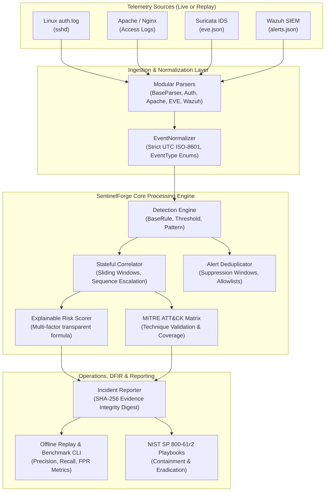

# SentinelForge — SOC Detection & Incident Response Platform

> **A modular, defensive cybersecurity platform integrating multi-source security telemetry, stateful correlation, explainable risk scoring, and automated NIST-aligned incident reporting.**

[](https://github.com/the-evilyn/SOC-Detection-Lab/actions/workflows/ci.yml)


[](LICENSE)


---

## 1. Project Overview

**SentinelForge** (developed on the foundation of [CedricCloudOps/soc-detection-lab](https://github.com/CedricCloudOps/soc-detection-lab)) is a defensive cybersecurity engineering and detection platform.

In modern Security Operations Centers (SOCs), isolated alert notifications from SIEMs or NIDS sensors generate alert fatigue and lack contextual progression. SentinelForge solves this by providing:

1. **Decoupled Telemetry Ingestion & Normalization:** Standardizes Linux authentication logs, Apache web access logs, Suricata EVE network records, and Wazuh alert streams into typed, schema-validated, timezone-aware UTC security events.
2. **Deterministic Detection Engine:** Executes pattern-matching and threshold-based rules mapped to the MITRE ATT&CK framework.
3. **Stateful Event Correlation:** Connects multi-stage attack tradecraft—such as repeated SSH authentication failures followed immediately by successful valid account access—into unified incidents.
4. **Explainable Multi-Factor Risk Scoring:** Replaces arbitrary scores with a transparent mathematical formula accounting for base severity, rule confidence, event frequency, and attack sequence escalation.
5. **False-Positive Management:** Suppresses alert storms through configurable time windows, deduplication keys, and benign allowlists.
6. **Offline Replay & Benchmarking:** A standalone CLI runner that evaluates detection algorithms and calculates precision, recall, and false-positive rates on labeled datasets without requiring Docker or network access.

---

## 2. System Architecture



---

## 3. Implemented Capabilities & Coverage

| Layer | Implemented Feature | Primary Module / Rule | MITRE ATT&CK |
|:---|:---|:---|:---|
| **Data Models** | Typed Security Models (`Event`, `Alert`, `Incident`, `RiskScore`) | `engine/models.py` | — |
| **Ingestion** | Resilient Parsers (Linux auth, Apache, Suricata, Wazuh) | `engine/ingestion/` | — |
| **Normalization** | Canonical Event Normalization (Strict UTC, schema validation) | `engine/normalization/` | — |
| **Detection** | SSH Authentication Failure Threshold (Brute Force) | `DET-SSH-001` | **T1110.001** |
| **Detection** | SQL Injection Indicators in Web Telemetry | `DET-WEB-001` | **T1190** |
| **Detection** | Directory Traversal Pattern Recognition | `DET-WEB-002` | **T1190** |
| **Correlation** | Stateful Sequence: SSH Brute Force $\rightarrow$ Compromise Escalation | `CORR-SSH-002` | **T1110.001, T1078** |
| **Risk Scoring** | Transparent Multi-factor Risk Calculator (0.0 to 100.0) | `engine/scoring/` | — |
| **Suppression** | Alert Deduplication & False-Positive Allowlisting | `engine/suppression/` | — |
| **Reporting** | Deterministic JSON & Markdown Reports with SHA-256 Hashing | `engine/reporting/` | — |
| **Evaluation** | Offline Replay CLI & Precision/Recall Metrics Calculation | `engine/evaluation/` | — |
| **Hardening** | Localhost-bound published ports (`127.0.0.1`) | `docker-compose.yml` | — |

---

## 4. Quick Start Guide

### Prerequisites
- Python 3.9+ (tested on Python 3.12 and 3.14)
- Docker & Docker Compose (optional, required only for live container lab)

### 1. Installation
```bash
# Clone the repository
git clone https://github.com/the-evilyn/SOC-Detection-Lab.git
cd SOC-Detection-Lab

# Optional: Set up virtual environment
python3 -m venv venv
source venv/bin/activate

# Install test dependencies
pip install -r requirements-dev.txt
```

### 2. Run Offline Telemetry Replay
Process raw sanitized logs through the detection, correlation, and scoring engine:
```bash
# Replay SSH authentication logs
python3 tools/sentinelforge_cli.py replay --file tests/fixtures/ssh_auth.log --format linux_auth

# Replay Apache web access logs
python3 tools/sentinelforge_cli.py replay --file tests/fixtures/apache_access.log --format apache_combined
```

### 3. Run Benchmark Detection Evaluation
Measure precision, recall, and false-positive rates on labeled datasets:
```bash
python3 tools/sentinelforge_cli.py benchmark --scenarios tests/fixtures/synthetic_events.json
```

### 4. Run Automated Test Suite
```bash
python3 -m pytest -v
python3 scripts/validate_sigma.py
```

---

## 5. Demonstration & Real Execution Output

### Offline Replay: Detecting SSH Brute Force & Compromise
```text
$ python3 tools/sentinelforge_cli.py replay --file tests/fixtures/ssh_auth.log --format linux_auth
=== SentinelForge Offline Replay Summary ===
File: ssh_auth.log | Format: linux_auth
Total Events Processed: 14
Alerts Generated:       4
Incidents Correlated:   2

--- Alerts ---
[HIGH] DET-SSH-001 - SSH brute-force activity detected: 5 failed authentications from 192.0.2.15 within 120s (Score: 83.5)
[HIGH] DET-SSH-001 - SSH brute-force activity detected: 6 failed authentications from 192.0.2.15 within 120s (Score: 85.5)
[HIGH] DET-SSH-001 - SSH brute-force activity detected: 7 failed authentications from 192.0.2.15 within 120s (Score: 87.5)
[HIGH] DET-SSH-001 - SSH brute-force activity detected: 8 failed authentications from 192.0.2.15 within 120s (Score: 89.5)

--- Incidents ---
[HIGH] INC-2CCD1A57 - Security Incident: SSH Authentication Failure Threshold (Brute Force) from 192.0.2.15 (Risk: 83.5/100)
[CRITICAL] INC-SSH-E019B4 - Critical: Possible SSH Compromise on web-01 from 192.0.2.15 (Risk: 95.0/100)
```

### Detection Quality Benchmark Output
```text
$ python3 tools/sentinelforge_cli.py benchmark --scenarios tests/fixtures/synthetic_events.json
=== SentinelForge Benchmark Evaluation ===
Scenarios Evaluated: 4
True Positives:      2
False Positives:     0
True Negatives:      2
False Negatives:     0
Precision:           100.00%
Recall:              100.00%
F1 Score:            100.00%
False Positive Rate: 0.00%
```

---

## 6. Security Hardening & Lab Isolation

The laboratory stack includes deliberately vulnerable targets for defensive evaluation:
- **Localhost Only (`127.0.0.1`):** In `docker-compose.yml`, all published ports are bound explicitly to `127.0.0.1` (`127.0.0.1:8080:80`, `127.0.0.1:55000:55000`). Vulnerable applications cannot be accessed from the local network or internet.
- **Minimal Capabilities:** Suricata uses `network_mode: "service:dvwa"` to share only DVWA's network namespace, avoiding host-level promiscuous access.
- **Read-Only Volume Mounts:** Detection rules and decoders are mounted with read-only (`:ro`) permissions.
- **Credential Safety:** Secrets are managed via `.env` (git-ignored). Telemetry fixtures strictly utilize RFC 5737 documentation IP prefixes (`192.0.2.0/24`, `198.51.100.0/24`, `203.0.113.0/24`).

---

## 7. Documentation Index

- [Architecture & Data Flow Guide](docs/ARCHITECTURE.md)
- [Detection Engineering & Rule Specification](docs/DETECTION_ENGINE.md)
- [Threat Model & Security Posture](docs/THREAT_MODEL.md)
- [Project Audit & Baseline Analysis](docs/PROJECT_AUDIT.md)
- [Engineering Roadmap & Acceptance Criteria](docs/ROADMAP.md)
- [SSH Incident Response Playbook](playbooks/ir-ssh-bruteforce.md)
- [Web Attack Incident Response Playbook](playbooks/ir-web-attack.md)

---

## 8. Attribution & License

- **SentinelForge Additions & Architecture:** © 2026 Evilyn (the-evilyn). Developed as a capstone cybersecurity engineering project at ENSI Tanger.
- **Original Educational Lab Foundation:** © 2026 Cedric Severin DJIGUIMDE ([CedricCloudOps/soc-detection-lab](https://github.com/CedricCloudOps/soc-detection-lab)).
- **License:** Released under the [MIT License](LICENSE).
