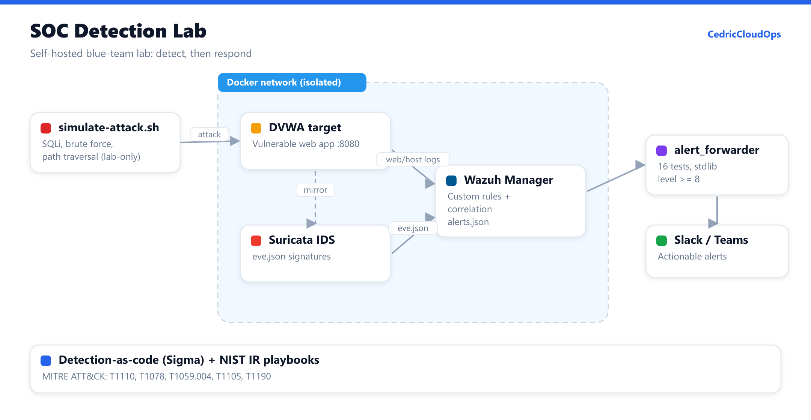
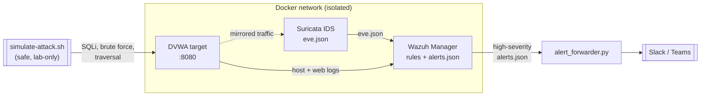

# SOC Detection Lab 🛰️

> A self-contained, **Docker-based blue-team lab**: Wazuh (SIEM/HIDS) + Suricata
> (network IDS) + a deliberately vulnerable target, shipped with **custom
> detection content**, **NIST-aligned incident-response playbooks**, and a
> tested **alert-forwarder**. Spin it up, attack it safely, watch the detections
> fire end-to-end.

[](https://github.com/CedricCloudOps/soc-detection-lab/actions/workflows/ci.yml)
[](tests/)
[](https://wazuh.com/)
[](https://suricata.io/)
[](https://github.com/SigmaHQ/sigma)
[](LICENSE)

🇫🇷 **Version française → [README.fr.md](README.fr.md)**



---

## Why this exists

Anyone can install a SIEM. What employers (and NGO security teams) actually want
to see is whether you can **write detections, run an investigation, and respond**.
This lab is the proof: portable detection-as-code, real correlation rules, and
runbooks you could hand to a junior analyst on day one — all reproducible with a
single `docker compose up`.

## What's inside

| Layer | Tech | Highlights |
|-------|------|-----------|
| **SIEM / HIDS** | Wazuh 4.9 | Custom correlation rules (`config/wazuh/local_rules.xml`): SSH brute-force escalation, *successful-login-after-bruteforce* compromise rule, `curl\|sh` execution, web SQLi |
| **Network IDS** | Suricata 7.0 | Local rules (`config/suricata/custom.rules`): port-scan, SSH brute force, SQLi, path traversal, suspicious downloads |
| **Detection-as-code** | Sigma | Portable rules in `detections/sigma/` + a structural validator run in CI |
| **Automation** | Python (stdlib) | `tools/alert_forwarder.py` streams high-severity alerts to Slack/Teams — **16 unit tests, 0 dependencies** |
| **Response** | Markdown | NIST SP 800-61 playbooks in `playbooks/` |
| **Attack sim** | Bash | `scripts/simulate-attack.sh` generates safe, lab-only telemetry |

## Architecture



See [docs/architecture.md](docs/architecture.md) for the data flow and detection
coverage matrix (MITRE ATT&CK mapping).

## Quick start

**Prerequisites:** Docker + Docker Compose. ~4 GB RAM free.

```bash
cp .env.example .env

# 1. Bring up the lab
docker compose up -d
./scripts/healthcheck.sh

# 2. Generate some attacks against the target
./scripts/simulate-attack.sh

# 3. Watch detections land, then forward the high-severity ones
docker compose exec wazuh.manager cat /var/ossec/logs/alerts/alerts.json > alerts.json
python tools/alert_forwarder.py --alerts alerts.json --min-level 8 --dry-run
```

> DVWA is reachable at <http://localhost:8080> (`admin` / `password`). The Wazuh
> REST API listens on `55000`. The optional indexer + dashboard need TLS certs;
> the bring-up notes are in [docs/architecture.md](docs/architecture.md).

## Detection coverage (MITRE ATT&CK)

| Technique | ID | Where it's caught |
|-----------|----|-------------------|
| Brute Force: Password Guessing | T1110.001 | Wazuh 100100 / Suricata 1000002 / Sigma |
| Valid Accounts (post-bruteforce) | T1078 | Wazuh 100101 (correlation) |
| Command & Scripting: Unix Shell | T1059.004 | Wazuh 100110 / Sigma |
| Ingress Tool Transfer | T1105 | Sigma + Suricata 1000005 |
| Exploit Public-Facing App (SQLi) | T1190 | Wazuh 100120 / Suricata 1000003 / Sigma |

## Develop & test

```bash
pip install -r requirements-dev.txt
ruff check tools tests scripts     # lint
pytest                             # 16 tests, <1s
python scripts/validate_sigma.py   # detection content
```

CI runs all of the above plus `yamllint`, `shellcheck`, and a `docker compose
config` validation on every push.

## ⚠️ Safety

This lab **intentionally** runs vulnerable software with weak credentials. Keep
it on an isolated host/network, never expose it to the internet, and only run
`simulate-attack.sh` against the bundled target.

## Roadmap

- [ ] Optional Wazuh indexer + dashboard with auto-generated certs
- [ ] TheHive + Cortex for case management
- [ ] Convert Sigma rules to Wazuh automatically via `sigma-cli`
- [ ] Active-response auto-blocking demo

## License

MIT © 2026 Cedric Severin DJIGUIMDE — see [LICENSE](LICENSE).
