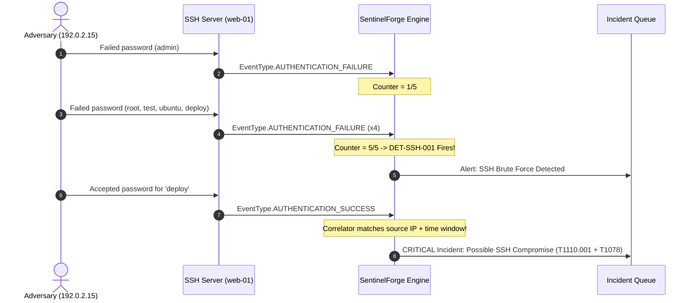

# SentinelForge — Detection Engineering & Rule Specification Guide

> **Author & Lead Engineer:** Evilyn (Final-Year Cybersecurity Engineering, ENSI Tanger)  
> **Platform:** SentinelForge Detection & Correlation Engine  
> **Document Version:** 1.0 (October 2026)

---

## 1. Detection Engineering Principles

In SentinelForge, detection rules adhere to five core engineering principles:

1. **Observable Behavior over Inferred Intent:** Rules match concrete, verifiable log characteristics rather than assuming malicious intent. A failed login is an authentication failure; an incident is created only when multiple correlated factors justify it.
2. **Strict Normalization Independence:** Rules operate strictly on strongly typed `engine.models.Event` instances. They never parse raw strings or deal with disparate vendor date formats.
3. **Transparent Signal-to-Noise Ratio (Confidence):** Every rule defines a `confidence` rating (0.0 to 1.0) alongside its base severity. This ensures high-signal deterministic rules are weighted appropriately compared to broad heuristics.
4. **Resilience to False Positives:** Pattern-matching rules enforce contextual syntax (e.g. distinguishing SQL commands from English search phrases like `credit union selection`).
5. **Traceable Evidence:** Every generated `Alert` preserves a list of `evidence_event_ids`, allowing an analyst to verify the exact raw events that triggered the detection.

---

## 2. Implemented Detection Rules

### Rule DET-SSH-001: SSH Authentication Failure Threshold (Brute Force)

| Attribute | Specification |
|:---|:---|
| **Rule ID** | `DET-SSH-001` |
| **Rule Name** | SSH Authentication Failure Threshold (Brute Force) |
| **Target Event** | `EventType.AUTHENTICATION_FAILURE` (`service == "sshd"`) |
| **Severity** | `HIGH` (Base Score: 65.0, Confidence: 0.85) |
| **MITRE ATT&CK** | **T1110.001** (Credential Access: Password Guessing) |
| **Threshold** | Default $\ge 5$ failures within $120$ seconds per source IP |
| **Stateful Tracking**| In-memory sliding time window indexed by `source_ip` |

#### Detection Logic
```python
# Cleans timestamps older than window_seconds
window_start = current_time.timestamp() - self.window_seconds
self._history[src_ip] = [
    (ts, eid) for ts, eid in self._history[src_ip] if ts.timestamp() >= window_start
]
self._history[src_ip].append((current_time, event.event_id))

if len(self._history[src_ip]) >= self.threshold:
    # Trigger Alert with all evidence event IDs
    ...
```

---

### Rule DET-WEB-001: SQL Injection Indicators in Web Request

| Attribute | Specification |
|:---|:---|
| **Rule ID** | `DET-WEB-001` |
| **Rule Name** | SQL Injection Indicators in Web Request |
| **Target Event** | `EventType.WEB_REQUEST` (`service == "apache"` / web proxy) |
| **Severity** | `HIGH` (Base Score: 70.0, Confidence: 0.80) |
| **MITRE ATT&CK** | **T1190** (Initial Access: Exploit Public-Facing Application) |
| **Patterns** | UNION SELECT, boolean tautologies (`' OR '1'='1`), time-based probes (`sleep(5)`), schema extraction |

#### False-Positive Mitigation
The rule URL-decodes the query string and tests for SQL syntactic boundaries (e.g., `(?i)\bunion\s+(?:all\s+)?select\b`). Natural language sentences containing words like "union" and "selection" (e.g. `/search?q=credit+union+selection`) do not trigger the detection.

---

### Rule DET-WEB-002: Directory Traversal Pattern in Web Request

| Attribute | Specification |
|:---|:---|
| **Rule ID** | `DET-WEB-002` |
| **Rule Name** | Directory Traversal Pattern in Web Request |
| **Target Event** | `EventType.WEB_REQUEST` |
| **Severity** | `MEDIUM` (Base Score: 55.0, Confidence: 0.85) |
| **MITRE ATT&CK** | **T1190** (Initial Access: Exploit Public-Facing Application) |
| **Patterns** | Path traversal sequences (`../`, `..\`, `%2e%2e%2f`), sensitive OS targets (`/etc/passwd`, `win.ini`) |

---

## 3. Stateful Correlation: The Compromise Sequence

While discrete alerts detect individual suspicious behaviors, real-world adversary operations span multi-stage sequences.



1. **Phase 1 (Credential Guessing):** Multiple authentication failures exceed threshold $\rightarrow$ Rule `DET-SSH-001` emits `Alert` (Severity: High, Score: 83.5).
2. **Phase 2 (Valid Account Login):** A successful login occurs for user `deploy` from the exact same source IP within 120 seconds.
3. **Phase 3 (Escalation to Incident):** `EventCorrelator` links the brute-force precursor to the valid account event, escalating the case to a **Critical Incident** (`INC-SSH-...`, Risk Score: 95.0) and recommending immediate host isolation.

---

## 4. Explainable Risk Scoring Methodology

SentinelForge computes risk scores on an absolute scale of **0.0 to 100.0** using the following deterministic formula:

$$\text{Risk Score} = \min\left(100.0, (\text{Base} \times (0.6 + 0.4 \times \text{Confidence})) + \text{Freq} + \text{Seq} + \text{Exp}\right)$$

### Components
1. **Base Severity ($\text{Base}$):**
   - Critical: `90.0`
   - High: `75.0`
   - Medium: `50.0`
   - Low: `25.0`
   - Informational: `10.0`
2. **Confidence Multiplier ($0.6 + 0.4 \times \text{Confidence}$):** Scales the base score based on rule fidelity (confidence 0.0 to 1.0).
3. **Frequency Boost ($\text{Freq}$):** Logarithmic scale $\min(15.0, 3.5 \times \ln(\text{count} + 1))$ to prevent event volume from inflating scores infinitely.
4. **Sequence Escalation Boost ($\text{Seq}$):** $+15.0$ points when multi-stage correlation detects a transition from reconnaissance/access attempt to execution/compromise.
5. **Asset Exposure Boost ($\text{Exp}$):** $+5.0$ points if the targeted asset is tagged as an external internet-facing boundary.
