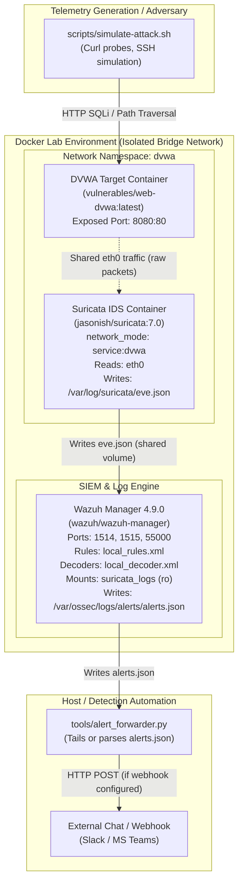
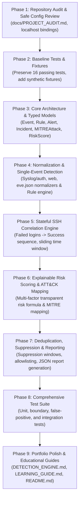

# SOC Detection Lab — Comprehensive Repository Audit & Safe Configuration Review

> **Audit Date:** October 2026<br>
> **Audited Repository:** [CedricCloudOps/soc-detection-lab](https://github.com/CedricCloudOps/soc-detection-lab)<br>
> **Target Fork / Portfolio Destination:** [the-evilyn/SentinelForge](https://github.com/the-evilyn/SentinelForge.git)<br>
> **Status:** Grounded inspection completed. Clean working tree, no running containers, no secrets detected.

---

## 1. Summary of the Original Project's Purpose

The upstream educational repository (`soc-detection-lab`) created by **Cedric Severin DJIGUIMDE (CedricCloudOps)** is a self-contained, Docker-based blue-team demonstration environment.

### Core Objectives of the Original Project
- **Practical Blue-Team Demonstration:** Provides a pre-packaged environment demonstrating how detection engineering, log correlation, and incident response playbooks function in practice, moving beyond standard SIEM installation.
- **Three-Tier Architecture:** Combines host log analysis and SIEM correlation (**Wazuh 4.9.0**), network intrusion detection (**Suricata 7.0**), and an intentionally vulnerable target (**Damn Vulnerable Web Application - DVWA**).
- **Detection-as-Code & Runbooks:** Ships portable **Sigma** rules, custom **Wazuh XML rules/decoders**, custom **Suricata rules**, and **NIST SP 800-61r2** aligned response playbooks.
- **Lightweight Alert Forwarding:** Implements an alert forwarder (`tools/alert_forwarder.py`) written in Python using only the standard library to forward high-severity Wazuh alerts to Slack or Microsoft Teams webhooks.

---

## 2. Architecture and Event Flow Analysis

### Architecture Overview



### Detailed Event Flow

1. **Telemetry Generation:** `scripts/simulate-attack.sh` sends HTTP requests containing SQL injection payloads and directory traversal strings to the DVWA web application on `http://localhost:8080`. It also contains a loop attempting SSH authentication using `sshpass`.
2. **Network Detection:** Because Suricata runs with `network_mode: "service:dvwa"` and `cap_add: [NET_ADMIN, NET_RAW]`, it shares DVWA's Linux network namespace. Suricata inspects raw TCP packets entering `eth0` and evaluates them against `config/suricata/custom.rules`. Matches generate JSON-formatted events in `/var/log/suricata/eve.json`.
3. **Log Ingestion & Analysis:** The Wazuh Manager mounts the Docker volume `suricata_logs` read-only at `/var/log/suricata`. Wazuh reads `eve.json` as well as its own internal event queues. Custom decoders (`config/wazuh/local_decoder.xml`) extract fields (e.g., `srcip`, `url`), and custom correlation rules (`config/wazuh/local_rules.xml`) evaluate event frequencies and state transitions. Matches are written to `/var/ossec/logs/alerts/alerts.json`.
4. **Alert Notification:** The Python script `tools/alert_forwarder.py` reads `alerts.json`, filters alerts where `level >= min_level` (default 8), formats them into Slack/Teams compatible JSON messages, and dispatches them via HTTP POST.

---

## 3. Directory-by-Directory Audit of Important Files

```
.
├── .env.example                     # Environment template (DVWA DB password, Webhook URL)
├── .github/
│   └── workflows/
│       └── ci.yml                   # GitHub Actions pipeline (Ruff, pytest, validate_sigma, yamllint, shellcheck, compose)
├── .gitignore                       # Standard ignore file (covers .env, pycache, venvs, logs, alerts.json, eve.json)
├── LICENSE                          # Original MIT License (Cedric Severin DJIGUIMDE, 2026)
├── README.md                        # English documentation and quickstart
├── README.fr.md                     # French version of documentation
├── config/
│   ├── suricata/
│   │   └── custom.rules             # 5 custom Suricata rules (SIDs 1000001 - 1000005)
│   └── wazuh/
│       ├── local_decoder.xml        # Custom XML decoder for web access logs
│       └── local_rules.xml          # 4 custom Wazuh rules (IDs 100100, 100101, 100110, 100120)
├── detections/
│   └── sigma/
│       ├── linux_curl_pipe_sh.yml   # Sigma rule: curl/wget piped to shell execution
│       ├── ssh_bruteforce.yml       # Sigma rule: SSH authentication failures threshold (count >= 8 in 120s)
│       └── web_sqli_attempt.yml     # Sigma rule: Web SQL injection probe strings
├── docker-compose.yml               # Service definitions: wazuh.manager, suricata, dvwa
├── docs/
│   ├── architecture.md              # High-level architecture notes & MITRE ATT&CK matrix
│   └── diagrams/
│       ├── architecture.png         # Architecture diagram image
│       └── architecture.svg         # Architecture vector graphic
├── playbooks/
│   ├── ir-ssh-bruteforce.md         # NIST IR playbook for SSH brute-force & credential compromise
│   └── ir-web-attack.md             # NIST IR playbook for web application SQL injection
├── pyproject.toml                   # Ruff configuration (py39 target, strict lint rules)
├── pytest.ini                       # Pytest configuration (pythonpath = tools, testpaths = tests)
├── requirements-dev.txt             # Development dependencies (pytest>=8.0, ruff>=0.6, PyYAML>=6.0)
├── scripts/
│   ├── healthcheck.sh               # Health check script for Docker containers and log presence
│   ├── simulate-attack.sh           # Safe synthetic attack simulation script
│   └── validate_sigma.py            # Custom Python script validating Sigma rule schema & unique IDs
├── tests/
│   └── test_alert_forwarder.py      # 16 unit tests validating alert_forwarder.py functionality
└── tools/
    └── alert_forwarder.py           # Stdlib Python script parsing alerts.json and sending webhooks
```

---

## 4. Current Detection Capabilities & Limitations

### Existing Detection Capabilities

| Detection Category | Implementation | Rule ID / SID | MITRE ATT&CK | Logic / Threshold |
|:---|:---|:---|:---|:---|
| **Port Scanning** | Suricata | SID `1000001` | Reconnaissance | SYN burst: 30 packets in 10s tracked by source IP |
| **SSH Brute Force (Network)** | Suricata | SID `1000002` | T1110.001 | 10 connections to port 22 in 60s tracked by source IP |
| **Web SQL Injection (Network)** | Suricata | SID `1000003` | T1190 | URI contains case-insensitive `union` followed by `select` |
| **Directory Traversal (Network)**| Suricata | SID `1000004` | Web Attack | URI contains `../` |
| **Malicious Shell Script Download**| Suricata | SID `1000005` | T1105 | Outbound HTTP URI ends with `.sh` |
| **SSH Brute Force (Host Log)** | Wazuh XML | Rule `100100` | T1110.001 | 8 failures (`if_matched_sid: 5710`) within 120s from same IP |
| **SSH Compromise after Brute Force**| Wazuh XML | Rule `100101` | T1110.001, T1078 | Successful login (`5715`) immediately following Rule `100100` from same IP |
| **Pipe to Shell Execution** | Wazuh XML | Rule `100110` | T1059.004, T1105 | Auditd log matching regex `.*(curl\|wget).*\|.*sh.*` |
| **Web SQL Injection (Host Log)** | Wazuh XML | Rule `100120` | T1190 | Web access log regex matching common SQL injection keywords |
| **Sigma Rule Catalog** | YAML | 3 Rules | T1110.001, T1059.004, T1105, T1190 | Generic rule specifications for SIEM compilation |

### Current Limitations and Architectural Gaps

1. **Missing SSH Daemon on Target:**
   - In `scripts/simulate-attack.sh`, attack simulation step 3 attempts SSH connections against `${TARGET}` (default `localhost`).
   - However, in `docker-compose.yml`, neither DVWA nor any other container runs an SSH daemon exposed on port 22. Running the script against `localhost` either fails with `Connection refused` or inadvertently targets the host machine's SSH daemon if one is running.
2. **Log Ingestion Disconnect between DVWA and Wazuh:**
   - Wazuh Manager mounts `/var/log/suricata` from the `suricata_logs` volume, so Suricata's `eve.json` is ingested.
   - However, DVWA's internal Apache web server access logs and MySQL logs are **not** forwarded to Wazuh (DVWA does not run a Wazuh agent, nor are its logs mounted into Wazuh or streamed over syslog). Therefore, Wazuh rule `100120` and decoder `lab-web-access` cannot fire in the current Docker setup without manual log shipping.
3. **No Standalone / Offline Detection Engine:**
   - The repository relies entirely on Wazuh's internal proprietary XML engine for log correlation and Suricata for packet matching.
   - The Python code (`alert_forwarder.py`) is merely a forwarding transport for pre-existing Wazuh alerts; it does not parse raw logs, perform correlation, group incidents, or compute risk scores.
4. **Lack of Explainable Risk Scoring and Incident Grouping:**
   - When Wazuh rules fire, each alert is emitted as an isolated JSON line.
   - There is no mechanism in the repository that links brute-force attempts with subsequent successful logins into a coherent **Incident timeline** with composite severity, confidence scoring, evidence tracking, and risk breakdown.
5. **Sigma Rules are Static Only:**
   - Sigma rules in `detections/sigma/` are validated for YAML syntax, but there is no engine to compile them or evaluate events against them offline.
6. **No Offline Telemetry Fixtures:**
   - All tests currently evaluate `tools/alert_forwarder.py` using mock Wazuh JSON. There are no test datasets containing synthetic raw authentication logs, web access logs, or network events to test detection logic offline without starting Docker.

---

## 5. Existing Tests & Verification Baseline

### Test Suite Execution
- **Framework:** `pytest` (v9.1.1 running under Python 3.14.4).
- **Configuration:** `pytest.ini` (`pythonpath = tools`, `testpaths = tests`, `addopts = -ra -q`).
- **Test File:** `tests/test_alert_forwarder.py`.
- **Execution Command:**
  ```bash
  python3 -m pytest
  ```
- **Observed Result:**
  ```text
  ................                                                         [100%]
  16 passed in 0.40s
  ```
- **Test Breakdown:**
  - `test_parse_alert_extracts_fields`: Verifies parsing of standard Wazuh alert JSON.
  - `test_parse_alert_skips_non_alerts` (5 parameterized cases): Verifies handling of empty, whitespace, malformed JSON, and non-alert dictionaries.
  - `test_severity_band` (6 parameterized cases): Verifies mapping of numeric levels (0 to 15) to labels (`low`, `medium`, `high`, `critical`).
  - `test_should_forward_respects_threshold`: Tests threshold filtering (`min_level=8` vs `min_level=11`).
  - `test_format_slack_message_shape`: Verifies Slack message attachment structure and color codes.
  - `test_format_slack_message_without_src_ip`: Verifies payload formatting when `src_ip` is missing.
  - `test_run_dry_run_counts_filtered`: Verifies CLI dry-run processing and output stream filtering.

### Detection Rule Validation
- **Script:** `scripts/validate_sigma.py`.
- **Execution Command:**
  ```bash
  python3 scripts/validate_sigma.py
  ```
- **Observed Result:**
  ```text
  OK   linux_curl_pipe_sh.yml
  OK   ssh_bruteforce.yml
  OK   web_sqli_attempt.yml

  3 rule(s) checked.
  ```

---

## 6. Docker Services, Exposed Ports, Networks, and Security Review

### Services & Port Mappings

| Service | Container Image | Exposed Ports | Network Binding | Privileges & Capabilities | Volume Mounts |
|:---|:---|:---|:---|:---|:---|
| `wazuh.manager` | `wazuh/wazuh-manager:4.9.0` | `1514/tcp`, `1515/tcp`, `55000/tcp` | Default: `0.0.0.0` (all host interfaces) | Standard, ulimits increased | `wazuh_etc`, `wazuh_logs`, `suricata_logs:ro`, custom XML configs (ro) |
| `suricata` | `jasonish/suricata:7.0` | None directly (shares DVWA netns) | `network_mode: "service:dvwa"` | `NET_ADMIN`, `NET_RAW` | `custom.rules:ro`, `suricata_logs` |
| `dvwa` | `vulnerables/web-dvwa:latest` | `8080:80` | Default: `0.0.0.0:8080` | Standard | None |

### Security Concerns & Lab Isolation Findings

> [!CAUTION]
> **1. Public Interface Exposure (`0.0.0.0`):**
> In `docker-compose.yml`, ports `8080`, `1514`, `1515`, and `55000` are bound without specifying an IP, which Docker defaults to `0.0.0.0`. If this lab is run on a workstation connected to a public/shared network or a cloud virtual machine, the intentionally vulnerable DVWA application and Wazuh management API are directly accessible to anyone on that network.
> **Remediation:** Bind all published ports explicitly to `127.0.0.1` (e.g. `127.0.0.1:8080:80`, `127.0.0.1:55000:55000`).

> [!WARNING]
> **2. Default and Insecure Credentials:**
> - `docker-compose.yml` provides a fallback `MYSQL_PASS=${DVWA_DB_PASSWORD:-changeme}`.
> - DVWA web interface uses default credentials `admin / password`.
> - Wazuh Manager API on port 55000 uses default credentials if unmodified.
> - While acceptable in an isolated local lab, explicit warnings and localhost binding are required.

> [!NOTE]
> **3. Elevated Capabilities (`NET_ADMIN`, `NET_RAW`):**
> Suricata requires `NET_ADMIN` and `NET_RAW` to capture packets in DVWA's network namespace. Using `network_mode: "service:dvwa"` is safe and isolates packet capture to the DVWA container without granting host-level promiscuous network access.

---

## 7. Missing Documentation & Configuration Audit

1. **Git Remote Setup:**
   - Current Git remote `origin` points to `https://github.com/CedricCloudOps/soc-detection-lab`.
   - The user's target repository is `https://github.com/the-evilyn/SentinelForge.git`.
   - A clear configuration step is needed to preserve upstream attribution (`git remote rename origin upstream` and `git remote add origin https://github.com/the-evilyn/SentinelForge.git`).
2. **Missing Custom Engine Documentation:**
   - No architectural documentation exists for a standalone Python detection/correlation engine that can run without Docker or Wazuh.
3. **No Synthetic Telemetry Fixtures:**
   - No offline test dataset (`tests/fixtures/`) is provided for developers or analysts to test detection rules against known benign and malicious event sequences.
4. **No Explainable Scoring Documentation:**
   - The existing project assigns static severity levels (0–15 in Wazuh, low/medium/high in Sigma) without explaining risk scoring formulas, confidence multipliers, or deduplication factors.

---

## 8. Prioritized Improvement Plan

Based on the audit and the project requirements, the following phased roadmap establishes our engineering milestones:



### Detailed Phase Breakdown

- **Phase 1: Repository Audit and Safe Configuration Review (Completed in this step)**
  - Audit repository files, git remotes, and baseline test suite.
  - Document all architectural layers, event flows, and container security risks in `docs/PROJECT_AUDIT.md`.
  - Prepare localhost-only (`127.0.0.1`) hardening recommendations for `docker-compose.yml`.

- **Phase 2: Test Baseline & Synthetic Event Telemetry**
  - Verify existing 16 tests continue passing.
  - Create synthetic, sanitized test event datasets (SSH brute force, successful post-bruteforce login, web SQL injection, and benign administrative activity) in `tests/fixtures/`.

- **Phase 3: Architecture & Typed Data Models**
  - Create package `engine/` with robust, strictly typed data structures using Python dataclasses and Enums (`engine/models.py`):
    - `Event` (normalized telemetry with timestamp, source, event_type, metadata).
    - `Rule` (rule definition, criteria, MITRE mapping, base severity).
    - `Alert` (single rule evaluation result).
    - `Incident` (correlated multi-alert container with timeline, aggregated risk score, and defensive evidence).
    - `RiskScore` (explainable scoring breakdown).

- **Phase 4: Event Normalization & Rule Engine**
  - Implement normalizers (`engine/normalizer.py`) converting heterogeneous raw logs (SSH auth logs, Suricata EVE JSON, Apache access logs) into normalized `Event` objects.
  - Implement single-event rule evaluation engine (`engine/rules.py`).

- **Phase 5: Stateful SSH Event Correlation**
  - Build `engine/correlator.py` capable of maintaining stateful sliding time windows.
  - Detect multiple SSH authentication failures within window (e.g. 8 in 120s) followed by successful authentication from the same source identifier.
  - Formulate linked incidents with full chronological event evidence.

- **Phase 6: Explainable Risk Scoring & MITRE ATT&CK Mapping**
  - Implement transparent scoring algorithm (`engine/scoring.py`):
    - Base severity (Low=20, Medium=50, High=75, Critical=90).
    - Frequency factor (logarithmic dampening to prevent infinite runaway).
    - Confidence score (signal-to-noise ratio).
    - Correlated escalation boost (e.g. brute force + successful login escalation).
    - Anti-double-counting logic.
  - Map detection rules to precise MITRE ATT&CK techniques with clear rationales.

- **Phase 7: False-Positive Management & Deterministic Incident Reporting**
  - Implement alert deduplication and suppression windows (`engine/suppression.py`).
  - Implement JSON incident report generator (`engine/reporter.py`) producing structured, sanitized incident summaries with recommended defensive actions.

- **Phase 8: Comprehensive Test Suite & Regression Verification**
  - Write extensive unit tests covering normalizers, rule evaluation, stateful correlation, boundary conditions, out-of-order events, suppression, and reporting.
  - Verify 100% pass rate without altering or weakening existing alert forwarder tests.

- **Phase 9: Portfolio Documentation & Git Remote Preparation**
  - Author `docs/DETECTION_ENGINE.md` detailing the custom engine architecture.
  - Author `docs/LEARNING_GUIDE.md` providing step-by-step educational explanations.
  - Update `README.md` to highlight custom contributions while maintaining full attribution to CedricCloudOps.
  - Present Git status and remote configuration options for user review and approval.
