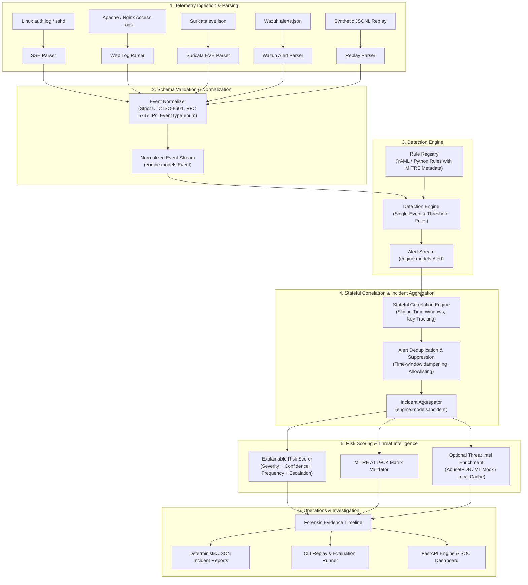

# SentinelForge — Technical Roadmap & Engineering Specification

> **Platform:** SentinelForge — Security Detection & Incident Response Platform<br>
> **Author & Lead Architect:** Evilyn (Final-Year Cybersecurity Engineering, ENSI Tanger)<br>
> **Repository:** [the-evilyn/SentinelForge](https://github.com/the-evilyn/SentinelForge)<br>
> **Document Version:** 1.0 (October 2026)

---

## 1. Executive Summary & Mission

**SentinelForge** transforms an educational Docker-based SOC lab into an extensible, security-hardened, and thoroughly tested **SOC Detection and Incident Response Platform**. 

Designed to demonstrate advanced competence across detection engineering, threat hunting, digital forensics and incident response (DFIR), and DevSecOps, SentinelForge implements a complete defensive pipeline:
1. Multi-source telemetry ingestion and validation.
2. Schema-enforced event normalization.
3. Modular detection rules (single-event and threshold-based).
4. Stateful sliding-window event correlation.
5. Incident grouping with chronological evidence timelines.
6. Transparent, multi-factor risk scoring.
7. MITRE ATT&CK enterprise technique mapping.
8. False-positive management, deduplication, and suppression.
9. Deterministic offline replay and evaluation against labeled datasets.
10. Incident reporting and optional threat intelligence enrichment.

---

## 2. Verified Technical Gap Analysis

A rigorous audit of the current repository against the target vision confirms the following technical baseline and gaps:

| Area | Current State in Repository | Target State in SentinelForge | Technical Gap & Required Work |
|:---|:---|:---|:---|
| **Git & Remotes** | `origin` -> `the-evilyn/SentinelForge`<br>`upstream` -> `CedricCloudOps/soc-detection-lab`<br>Clean history preserved (1 commit). | Maintained cleanly with signed, well-structured commits once approved. | Configuration verified; no code pushed. |
| **Test Baseline** | 56 tests passing (16 alert forwarder + 5 fixtures + 35 models). 3 Sigma rules valid. | Comprehensive unit, integration, boundary, and offline replay test suite (>120 tests). | Need tests for ingestion, normalization, detection, correlation, suppression, and reporting. |
| **Network Exposure** | `docker-compose.yml` binds `8080`, `1514`, `1515`, `55000` to `0.0.0.0` (all host interfaces). | All container ports bound strictly to `127.0.0.1` (localhost). | Vulnerable DVWA and Wazuh API exposed on untrusted networks; requires immediate localhost restriction. |
| **Lab SSH Target** | `scripts/simulate-attack.sh` connects to `baduser@localhost:22`, but no container runs SSH on port 22. | Explicit synthetic SSH fixtures for offline testing + dedicated lab SSH container or target config. | Live script fails with connection refused or inadvertently hits host SSH; offline fixtures now in place. |
| **Apache Log Ingestion** | DVWA container does not mount `/var/log/apache2`, nor does it run a Wazuh agent. Apache access logs never reach Wazuh. | Shared volume or syslog streaming for Apache logs, plus direct Python normalizer for Apache logs. | Wazuh rule `100120` (SQLi) cannot fire in Docker without Apache log volume mount; Python normalizer needed. |
| **Detection Engine** | Wazuh XML rules and static Sigma YAML; Python code only forwarded pre-fired Wazuh alerts. | Modular Python detection engine supporting single-event, threshold, and sequence rules. | `engine/models.py` established; ingestion, normalization, detection, and correlation engines needed. |
| **Event Correlation** | Stateful logic trapped inside Wazuh manager (`<if_matched_sid>100100</if_matched_sid>`). | Python stateful correlator with sliding time windows, correlation keys, and explainable incident generation. | Missing sliding-window state machine in Python. |
| **Risk Scoring** | Static severity levels (0–15 in Wazuh, High in Sigma) without factor breakdowns. | Explainable risk scoring model (0–100) combining severity, frequency, confidence, and asset context. | `RiskScore` model exists; algorithmic scoring calculator needed. |
| **False-Positive Handling** | No suppression windows or alert deduplication in code. | Configurable suppression windows, deduplication keys, and benign allowlisting. | Missing suppression and deduplication engine. |
| **Investigation & Replay** | No offline replay or forensic evidence export. | CLI-based offline replay (`sentinelforge replay`), evidence integrity hashing, JSON incident reports. | Missing replay runner, CLI entry point, and report generator. |

---

## 3. Proposed Target Architecture



---

## 4. Proposed Directory Structure

```text
SentinelForge/
├── .env.example                     # Environment template (DVWA credentials, optional webhook/API keys)
├── .github/
│   └── workflows/
│       ├── ci.yml                   # CI pipeline (Linting, pytest, Sigma validation, Yamllint, Shellcheck)
│       └── security-scan.yml        # DevSecOps pipeline (Trivy container scan, Bandit static analysis)
├── config/
│   ├── suricata/
│   │   └── custom.rules             # Network IDS rules (SIDs 1000001 - 1000005)
│   └── wazuh/
│       ├── local_decoder.xml        # Web access log XML decoder
│       └── local_rules.xml          # Stateful correlation XML rules
├── datasets/                        # Labeled evaluation datasets
│   ├── authentication/
│   │   ├── ssh_bruteforce_compromise.jsonl
│   │   └── ssh_benign_typo.jsonl
│   ├── web/
│   │   ├── web_sqli_attack.jsonl
│   │   └── web_benign_search.jsonl
│   └── network/
│       └── suricata_alerts.jsonl
├── detections/
│   └── sigma/                       # Portable Sigma rules
│       ├── linux_curl_pipe_sh.yml
│       ├── ssh_bruteforce.yml
│       └── web_sqli_attempt.yml
├── docker-compose.yml               # Hardened Docker Compose (localhost-bound ports)
├── docs/
│   ├── ARCHITECTURE.md              # Deep-dive architecture and data-flow documentation
│   ├── DETECTION_ENGINE.md          # Custom detection engine design & examples
│   ├── LEARNING_GUIDE.md            # Step-by-step SOC analyst learning walk-through
│   ├── PROJECT_AUDIT.md             # Grounded repository audit & verification
│   ├── ROADMAP.md                   # This document
│   └── diagrams/                    # Visual diagrams (SVG & PNG)
├── engine/                          # SentinelForge Core Python Engine
│   ├── __init__.py                  # Public exports
│   ├── config.py                    # Engine configuration & thresholds
│   ├── models.py                    # Typed core data models (Event, Alert, Incident, etc.)
│   ├── ingestion/                   # Modular log parsers
│   │   ├── __init__.py
│   │   ├── base.py                  # Abstract parser interface
│   │   ├── auth_log.py              # Syslog / sshd parser
│   │   ├── apache_log.py            # Apache combined log parser
│   │   ├── suricata_eve.py          # Suricata EVE JSON parser
│   │   └── wazuh_alerts.py          # Wazuh alerts.json parser
│   ├── normalization/               # Normalization engine
│   │   ├── __init__.py
│   │   └── normalizer.py            # Canonical Event normalizer
│   ├── detection/                   # Rule evaluation engine
│   │   ├── __init__.py
│   │   ├── engine.py                # Detection engine runner
│   │   ├── rule.py                  # Rule base class & metadata
│   │   └── rules/                   # Built-in detection rules
│   │       ├── ssh_bruteforce.py    # DET-SSH-001 (Threshold failure)
│   │       ├── ssh_compromise.py    # DET-SSH-002 (Success after failure)
│   │       ├── web_sqli.py          # DET-WEB-001 (SQL injection)
│   │       └── web_traversal.py     # DET-WEB-002 (Path traversal)
│   ├── correlation/                 # Stateful correlation engine
│   │   ├── __init__.py
│   │   ├── correlator.py            # Sliding time-window correlation engine
│   │   └── window.py                # Time-window tracking & sliding state
│   ├── scoring/                     # Explainable risk scoring
│   │   ├── __init__.py
│   │   └── scorer.py                # Multi-factor transparent scoring model
│   ├── suppression/                 # Deduplication & False-Positive management
│   │   ├── __init__.py
│   │   └── deduplicator.py          # Suppression windows & allowlist filtering
│   ├── reporting/                   # Deterministic incident reporting
│   │   ├── __init__.py
│   │   └── reporter.py              # JSON and Markdown report generator
│   ├── evaluation/                  # Replay & metric calculation
│   │   ├── __init__.py
│   │   └── replay.py                # Offline replay engine & confusion matrix
│   └── mitre/                       # ATT&CK taxonomy & validation
│       ├── __init__.py
│       └── attack_matrix.py         # MITRE technique catalog & coverage mapper
├── integrations/                    # Optional external integrations
│   ├── __init__.py
│   ├── threat_intel.py              # Extensible IOC enrichment interface (AbuseIPDB/Mock)
│   └── webhook.py                   # Slack / Teams alert dispatcher
├── playbooks/                       # Incident response runbooks (NIST SP 800-61r2)
│   ├── ir-ssh-bruteforce.md
│   └── ir-web-attack.md
├── pyproject.toml                   # Ruff configuration
├── pytest.ini                       # Pytest configuration
├── requirements-dev.txt             # Development dependencies
├── scripts/                         # Operational & simulation scripts
│   ├── healthcheck.sh               # Stack health check
│   ├── simulate-attack.sh           # Safe lab telemetry generator
│   └── validate_sigma.py            # Sigma syntax & UUID validator
├── tests/                           # Comprehensive test suite
│   ├── fixtures/                    # Sanitized raw and structured telemetry
│   │   ├── README.md
│   │   ├── apache_access.log
│   │   ├── ssh_auth.log
│   │   ├── suricata_eve.json
│   │   └── synthetic_events.json
│   ├── test_alert_forwarder.py      # Upstream alert forwarder tests (preserved)
│   ├── test_fixtures.py             # Fixture integrity tests
│   ├── test_models.py               # Data model unit tests
│   ├── unit/                        # Granular component tests
│   └── integration/                 # End-to-end pipeline tests
└── tools/
    ├── alert_forwarder.py           # Upstream alert forwarder (preserved)
    └── sentinelforge_cli.py         # SentinelForge unified CLI entry point
```

---

## 5. Security Hardening Plan

1. **Localhost Port Publishing:**
   - Modify `docker-compose.yml` to bind all ports strictly to `127.0.0.1`:
     - `127.0.0.1:8080:80` (DVWA)
     - `127.0.0.1:55000:55000` (Wazuh REST API)
     - `127.0.0.1:1514:1514` (Agent connection)
     - `127.0.0.1:1515:1515` (Agent enrollment)
2. **Minimal Privileges & Isolated Namespaces:**
   - Keep Suricata bound via `network_mode: "service:dvwa"` with strictly required `NET_ADMIN` and `NET_RAW` capabilities.
   - Run containers with non-root users where supported by upstream base images.
   - Enforce read-only volume mounts (`:ro`) for all custom rules and configuration files.
3. **Defense-in-Depth for Telemetry:**
   - Mount DVWA Apache access logs to a shared read-only volume (`dvwa_logs`) so Wazuh and SentinelForge parsers can ingest live access logs safely.
4. **Secret Management & Sanitization:**
   - Keep `.env` strictly git-ignored.
   - Enforce regex-based redacting of credentials or session tokens in raw log ingestion before generating incident reports.

---

## 6. SentinelForge Implementation Phases & Acceptance Criteria

```mermaid
flowchart LR
    P1["Phase 1: Hardening & Baselines"] --> P2["Phase 2: Ingestion & Normalization"]
    P2 --> P3["Phase 3: Detection Engine"]
    P3 --> P4["Phase 4: Stateful Correlation"]
    P4 --> P5["Phase 5: Risk Scoring & ATT&CK"]
    P5 --> P6["Phase 6: Deduplication & Reports"]
    P6 --> P7["Phase 7: Offline Replay"]
    P7 --> P8["Phase 8: DFIR Timelines & TI"]
    P8 --> P9["Phase 9: API & Dashboard"]
    P9 --> P10["Phase 10: Documentation & Release"]
```



### Phase 1: Security Hardening & Environment Baseline
- **Objective:** Fix network exposure in `docker-compose.yml` and establish verified baseline.
- **Acceptance Criteria:**
  - All published ports in `docker-compose.yml` explicitly bind to `127.0.0.1`.
  - Apache log volume mount added to bridge the DVWA-to-Wazuh ingestion gap.
  - `docker compose config` validates cleanly without syntax errors.
  - All 56 existing unit tests pass without regressions.

### Phase 2: Ingestion & Telemetry Normalization Engine
- **Objective:** Build modular parsers for SSH, Apache, Suricata, and Wazuh logs that emit validated `engine.models.Event` objects.
- **Acceptance Criteria:**
  - Base parser interface defined in `engine/ingestion/base.py`.
  - Parsers implemented for `ssh_auth.log`, `apache_access.log`, `suricata_eve.json`, and `alerts.json`.
  - Normalizer converts timestamps into UTC ISO-8601 datetimes.
  - Malformed lines are recorded as rejected events with line numbers rather than crashing the pipeline.
  - Unit tests verify parsing of both valid and malformed inputs.

### Phase 3: Modular Detection Engine
- **Objective:** Build rule execution framework supporting single-event pattern matching and threshold rules.
- **Acceptance Criteria:**
  - Base rule class `Rule` with attributes: `rule_id`, `name`, `severity`, `mitre_techniques`, `evaluate(event)`.
  - Rules implemented:
    - `DET-SSH-001`: SSH Brute Force (>= 8 failures within 120s from single IP).
    - `DET-WEB-001`: Web SQL Injection indicators in URI parameters.
    - `DET-WEB-002`: Directory traversal patterns (`../`).
  - Unit tests prove rules detect true-positive attacks and do not trigger on benign traffic (e.g. `credit union selection`).

### Phase 4: Stateful Event Correlation & Incident Aggregation
- **Objective:** Build sliding time-window state engine connecting discrete alerts into unified `Incident` cases.
- **Acceptance Criteria:**
  - Sliding time window tracks events by composite keys (`source_ip`, `target_host`, `user`).
  - Detects multi-event sequence: 8 failed SSH logins followed by successful login from the same IP within 120s.
  - Generates correlated `Incident` object without duplicating cases on repeated events.
  - Chronological evidence timeline records exact event sequence and timestamps.
  - Tests verify sliding window expiration, out-of-order events, and late-arriving telemetry.

### Phase 5: Transparent Risk Scoring & MITRE ATT&CK Mapping
- **Objective:** Implement an explainable risk scoring algorithm and validated ATT&CK technique catalog.
- **Acceptance Criteria:**
  - Multi-factor risk formula: $\text{Risk} = \min\left(100, (\text{Base} \times \text{Confidence}) + \text{FreqFactor} + \text{EscalationFactor}\right)$.
  - Documented factors explaining the exact contribution of each component.
  - Avoids double-counting evidence across correlated alerts.
  - MITRE coverage matrix validates technique IDs and tactics.
  - Tests prove boundary handling (0.0 to 100.0) and verify mathematical determinism.

### Phase 6: Alert Deduplication, False-Positive Management & Incident Reporting
- **Objective:** Suppress alert fatigue, support allowlisting, and export deterministic JSON/Markdown reports.
- **Acceptance Criteria:**
  - Configurable suppression windows prevent alert storms from repeated identical activity.
  - Benign allowlist filters known administrative IP addresses or health-check endpoints.
  - Deterministic JSON incident reporter creates sanitized incident summaries with recommended defensive actions (NIST playbooks).
  - Tests demonstrate suppression metrics and report schema compliance.

### Phase 7: Offline Replay Engine & Detection Evaluation
- **Objective:** Build CLI offline replay tool (`sentinelforge replay`) evaluating labeled datasets.
- **Acceptance Criteria:**
  - Processes JSONL datasets through the full pipeline without network or Docker requirements.
  - Computes detection metrics: True Positives, False Positives, False Negatives, Precision, and Recall.
  - Outputs machine-readable evaluation report (`replay-results.json`).
  - Tests verify deterministic results across repeated runs.

### Phase 8: DFIR Evidence Timeline & Threat Intelligence Enrichment
- **Objective:** Implement forensic search, timeline export with SHA-256 integrity verification, and optional IOC enrichment.
- **Acceptance Criteria:**
  - Forensic search filter by IP, username, hostname, and time range.
  - Evidence export includes SHA-256 hash of original raw telemetry.
  - Optional IOC enrichment interface supporting mocked or cached reputation lookups (AbuseIPDB format).
  - 100% functional offline when no API keys are provided.

### Phase 9: REST API & Lightweight SOC Dashboard
- **Objective:** FastAPI backend providing operational endpoints and lightweight dashboard.
- **Acceptance Criteria:**
  - REST endpoints for Incidents, Alerts, Replay, and System Health.
  - Read-only investigation dashboard views.
  - Automated API test suite using `TestClient`.

### Phase 10: Portfolio Polish, Documentation & Review
- **Objective:** Complete comprehensive documentation, visual architecture diagrams, and interview walkthrough guide.
- **Acceptance Criteria:**
  - `README.md` completely updated with honest feature status, architecture diagrams, and quickstart commands.
  - `docs/ARCHITECTURE.md`, `docs/DETECTION_ENGINE.md`, and `docs/LEARNING_GUIDE.md` complete.
  - Zero linter warnings, zero failing tests, clean Git history ready for final push review.

---

## 7. High-Value Interview & Portfolio Highlights

For technical interviews in SOC Analysis, Detection Engineering, and Cybersecurity Engineering, SentinelForge demonstrates:

1. **Stateful Correlation over Naive Pattern Matching:** Proves understanding of why single alerts are noisy and demonstrates how to connect multi-stage adversary tradecraft (T1110 -> T1078) statefully.
2. **Transparent, Explainable Risk Scoring:** Demonstrates mathematical rigor and defensive realism by avoiding "black-box" scores and providing analysts with clear factor breakdowns.
3. **False-Positive Resistance & Signal-to-Noise Focus:** Shows empathy for real-world SOC analysts by engineering suppression windows, deduplication, and testing against benign English strings.
4. **Deterministic Offline Replay & Quality Metrics:** Bridges software engineering and detection engineering by measuring precision, recall, and detection latency on labeled datasets.
5. **Defense-in-Depth & Secure Defaults:** Exhibits DevSecOps maturity by binding lab services to localhost, isolating container namespaces, sanitizing evidence, and maintaining rigorous automated test suites.
