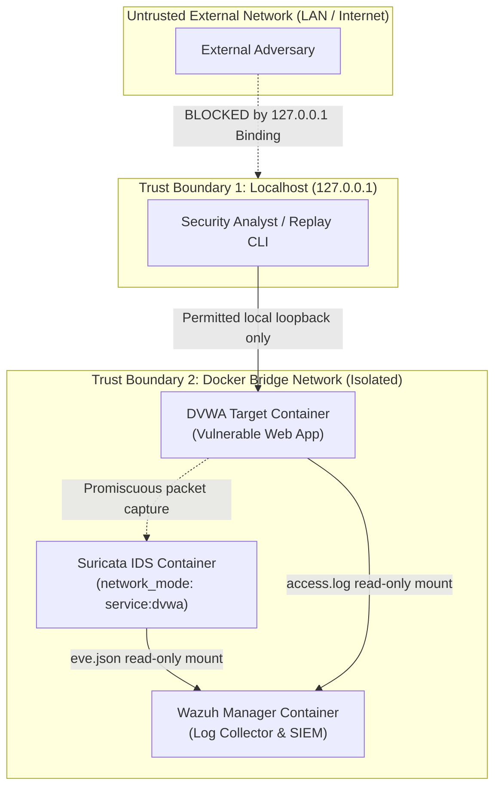

# SentinelForge — Lab Threat Model & Security Posture

> **Author & Lead Engineer:** Evilyn (Final-Year Cybersecurity Engineering, ENSI Tanger)  
> **Platform:** SentinelForge Lab Environment  
> **Document Version:** 1.0 (October 2026)

---

## 1. System Scope & Context

The SentinelForge lab environment is designed for defensive security training, telemetry generation, detection rule authoring, and incident response evaluation. It contains both defensive monitoring tools (Wazuh SIEM, Suricata IDS, SentinelForge Engine) and intentionally vulnerable target software (DVWA).

---

## 2. Trust Boundaries & Network Architecture

---

## 3. Threat Matrix & Countermeasures

| Threat ID | Threat Description | Attacker Objective | Impact | SentinelForge Countermeasure |
|:---|:---|:---|:---|:---|
| **THREAT-01** | External Network Exploitation of DVWA | Exploit known web flaws from local LAN or Internet | High (Target compromise) | **Mitigated:** All published ports bound strictly to `127.0.0.1` (`127.0.0.1:8080:80`). External connections receive `Connection refused`. |
| **THREAT-02** | Unauthorized Access to Wazuh Management API | Access SIEM REST API on port 55000 | Critical (SIEM tamper) | **Mitigated:** Port 55000 bound strictly to `127.0.0.1:55000:55000`. |
| **THREAT-03** | Host Network Sniffing via Suricata | Capture unintended traffic from host or other containers | Medium (Data leak) | **Mitigated:** Suricata uses `network_mode: "service:dvwa"`, confining packet capture strictly to DVWA's network namespace. |
| **THREAT-04** | Container File Tampering | Modify detection rules or decoders at runtime | High (Bypass detections) | **Mitigated:** All rules (`custom.rules`, `local_rules.xml`, `local_decoder.xml`) mounted with `:ro` (read-only) flags. |
| **THREAT-05** | Credential Leakage in Source Control | Accidental commit of API keys or lab passwords | High (Credential exposure) | **Mitigated:** Real `.env` file git-ignored; only non-sensitive templates with placeholder values committed. |

---

## 4. Responsible Use & Operational Guardrails

1. **Authorization:** Attack simulations (`scripts/simulate-attack.sh`) and offline replays must only be targeted against the Bundled DVWA target or synthetic offline datasets.
2. **No Automated Offensive Actions:** SentinelForge is an active monitoring and incident response platform. It does not automatically modify external firewall rules, block IP addresses without human triage, or execute offensive payloads.
3. **Data Sanitization:** Synthetic event fixtures strictly utilize RFC 5737 documentation IP prefixes (`192.0.2.0/24`, `198.51.100.0/24`, `203.0.113.0/24`) to prevent accidental disclosure or targeting of real systems.
