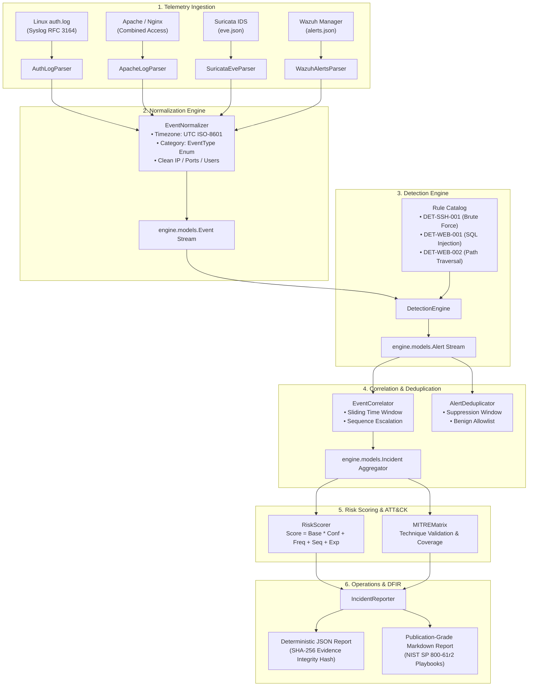

# SentinelForge — System Architecture & Data Flow

> **Platform:** SentinelForge — Advanced SOC Detection & Incident Response Platform 
> **Author & Lead Engineer:** Evilyn (Final-Year Cybersecurity Engineering, ENSI Tanger) 
> **Foundation:** Extended from [CedricCloudOps/soc-detection-lab](https://github.com/CedricCloudOps/soc-detection-lab)
> **Repository:** [the-evilyn/SOC-Detection-Lab](https://github.com/the-evilyn/SOC-Detection-Lab)

---

## 1. System Overview

SentinelForge is a modular defensive security platform designed to bridge the gap between raw, heterogeneous security telemetry and actionable incident response. It complements SIEM and NIDS tools (such as Wazuh and Suricata) by providing:

1. **Schema-Enforced Normalization:** Ingestion of Linux authentication logs, web access logs, and network alerts into canonical, typed event data structures.
2. **Stateful Event Correlation:** Identifying multi-stage attack tradecraft (such as brute force transitioning to valid account authentication) across configurable sliding time windows.
3. **Transparent Risk Scoring:** A mathematical multi-factor scoring algorithm that provides analysts with clear component breakdowns rather than opaque numbers.
4. **Offline Replay & Benchmarking:** A zero-dependency CLI runner that deterministically processes telemetry and benchmarks detection precision and recall against labeled datasets.

---

## 2. End-to-End Processing Pipeline

---

## 3. Core Architectural Components

### A. Ingestion Layer (`engine/ingestion/`)
- **`BaseParser` Interface:** All parsers inherit from `BaseParser`, defining `parse_line()` and `parse_stream()`.
- **Stream Resilience:** When a parser encounters a corrupted line, it logs a `ParseError(line_number, raw_line, error_message)` into an `IngestionResult` rather than aborting stream execution.
- **Format Parsers:**
  - `AuthLogParser`: Extracts timestamps, hostnames, PIDs, auth methods, target users, and source IPs from BSD syslog lines.
  - `ApacheLogParser`: Extracts client IPs, HTTP methods, URIs, query parameters, status codes, user agents, and referers.
  - `SuricataEveParser`: Parses Suricata EVE JSON objects for alerts, flows, and HTTP transactions.
  - `WazuhAlertsParser`: Ingests Wazuh manager alert records and rule levels.

### B. Normalization Layer (`engine/normalization/`)
- **`EventNormalizer`:** Translates format-specific `ParsedRecord` instances into canonical `engine.models.Event` instances.
- **Timezone Invariant:** Strictly converts all incoming timestamps to timezone-aware UTC datetime objects (`ensure_utc()`).
- **Semantic Mapping:** Maps disparate log messages to `EventType` enums:
  - `AUTHENTICATION_FAILURE`
  - `AUTHENTICATION_SUCCESS`
  - `WEB_REQUEST`
  - `NETWORK_ALERT`
  - `NETWORK_FLOW`
  - `COMMAND_EXECUTION`

### C. Detection Engine (`engine/detection/`)
- **`BaseRule`:** Defines rule metadata, MITRE techniques, severity, base score, and confidence.
- **`DetectionEngine`:** Manages rule registration and stream evaluation.
- **Built-in Detections:**
  - `DET-SSH-001`: Threshold-based SSH brute-force detection (configurable threshold and window).
  - `DET-WEB-001`: SQL injection pattern detection in URI query parameters (decodes URL encoding, inspects tautologies, UNION SELECT, time-based probes).
  - `DET-WEB-002`: Directory traversal pattern detection (`../`, encoded dots, `/etc/passwd`).

### D. Stateful Correlation (`engine/correlation/`)
- **Sliding Time Windows:** Tracks event histories per `source_ip` across sliding windows (e.g., 120s–180s).
- **Sequence Escalation:** When a successful login occurs from an IP address that tripped `DET-SSH-001` within the correlation window, the correlator generates a `CRITICAL` incident (`INC-SSH-...`) representing probable account compromise (mapping `T1110.001` and `T1078`).
- **Incident Aggregation:** Groups related alerts from the same source into a unified incident, maintaining an ordered chronological evidence timeline.

### E. Risk Scoring Model (`engine/scoring/`)
- **Formula:**
  $$\text{Score} = \min\left(100.0, (\text{Base} \times (0.6 + 0.4 \times \text{Confidence})) + \text{FreqBoost} + \text{SequenceBoost} + \text{ExposureBoost}\right)$$
- **Factor Transparency:** Prevents black-box scores by returning a dictionary of factor weights and an auditable rationale string.
- **Anti-Double-Counting:** Dampens frequency increases logarithmically to avoid infinite runaway scores.

### F. Alert Deduplication & False-Positive Management (`engine/suppression/`)
- **`AlertDeduplicator`:** Suppresses repeated identical alerts matching `(rule_id, source_ip, target_host)` within a configurable suppression window (e.g., 60s).
- **Allowlisting:** Filters trusted IP addresses (such as `127.0.0.1` health checks) and service accounts (such as `backup_svc`) with explicit recorded reasons.

### G. Reporting & DFIR Integrity (`engine/reporting/`)
- **`IncidentReporter`:** Outputs deterministic JSON and Markdown reports.
- **Evidence Integrity:** Computes a SHA-256 digest over concatenated raw logs in chronological sequence, establishing forensic evidence verification.
- **NIST Alignment:** Generates containment, eradication, and recovery recommendations aligned with NIST SP 800-61r2.
